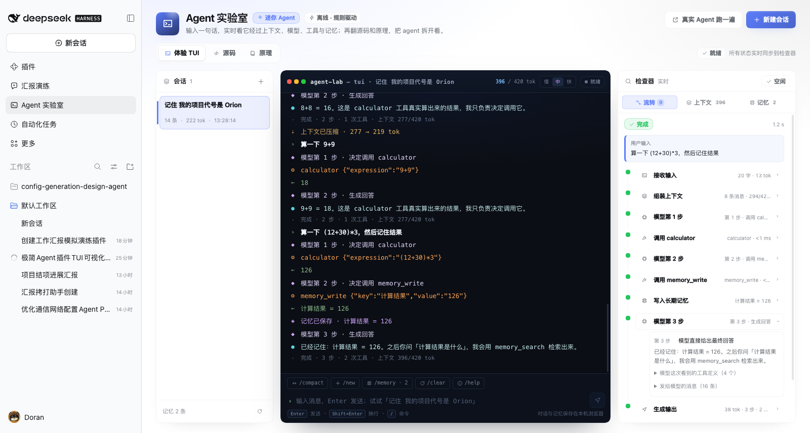
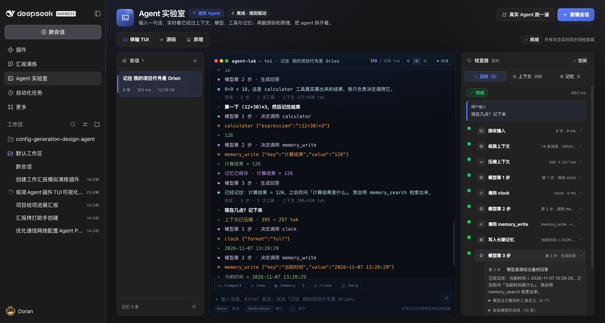
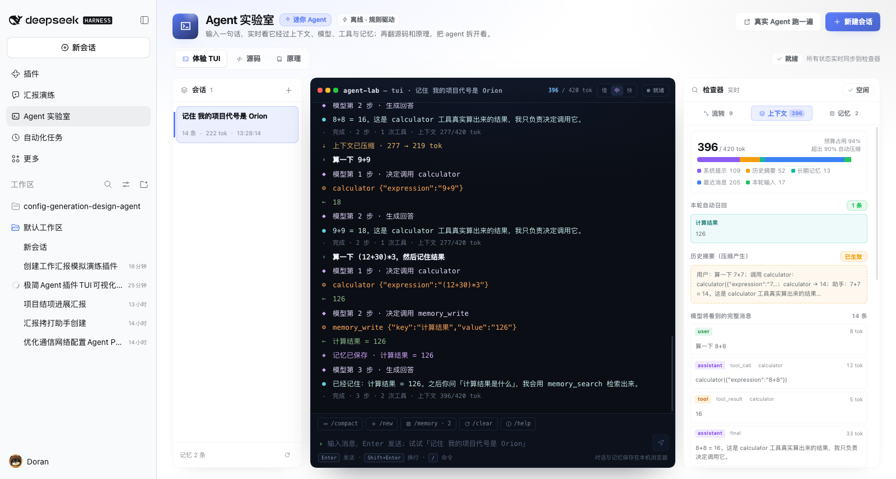
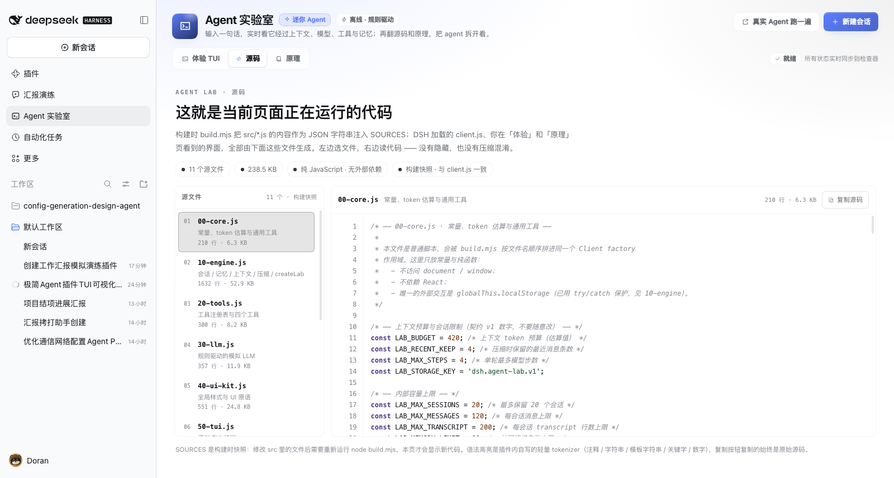
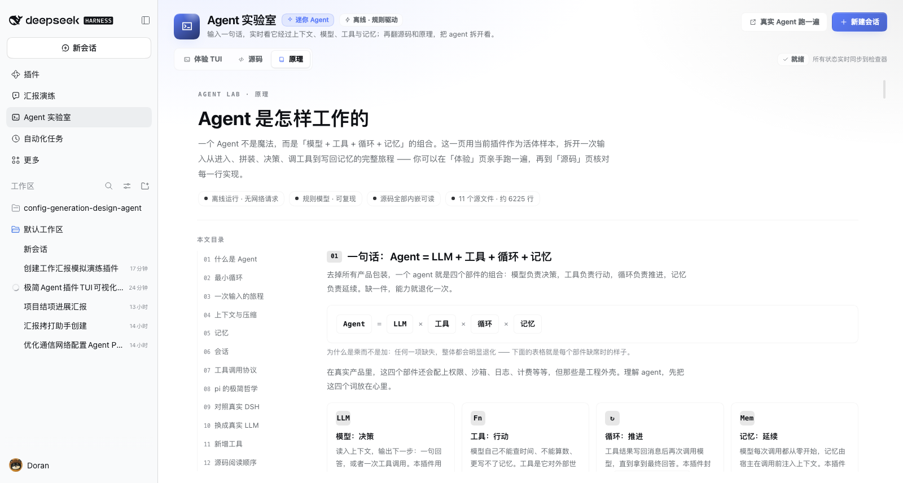
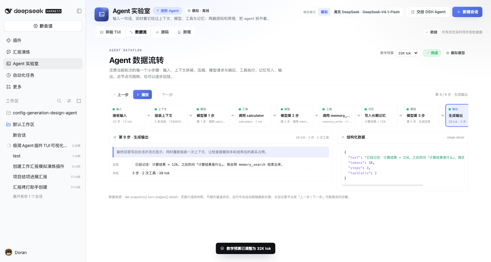

# Agent 实验室 · Agent Lab

在 DSH Web UI 里打开的一间「Agent 解剖教室」：左边是会话，中间是一个模拟的 TUI 终端，右边是实时检查器。输入一句话，就能看到它如何经过 **上下文组装 → 模型决策 → 工具调用 → 记忆写入 → 输出**，并且能随时翻到「源码」页看正在运行的代码、到「原理」页把 agent 的骨架读明白。

- **默认可离线，也能接真模型**：默认是规则驱动的模拟模型，不联网、无需 API key、回答可复现；终端右上角可切到「真实」模式，用 DSH 当前登录的 DeepSeek 账号模型跑同一个循环。
- **完全可读**：插件自己的 13 个客户端源文件 + Host 半侧 `index.js` 在构建时全部内嵌，「源码」页所见即所跑。
- **教学向**：三栏界面 + 12 节中文原理长文 + 轻量语法高亮源码浏览器。
- **零依赖**：Client 半侧只依赖 DSH 提供的 React，没有第三方包。

---

## 预览

浅色主题（真实 DSH Web UI 截图，左中右三栏：会话 / TUI / 检查器）：



深色主题，右侧「流转」里可以看到压缩阶段与本轮的工具调用链：



「上下文」检查器：token 分段、本轮召回、压缩摘要与模型实际收到的消息：



「源码」页与「原理」页：





---

## 快速开始

### 0. 前置条件

- DSH Web UI（当前 profile 已启用 Web 客户端）。
- Node.js 18+，用于构建 `client.js` 与运行无头测试。

### 1. 构建

```bash
cd agent-lab-plugin
node build.mjs          # 生成 client.js，并用 node:vm 做语法校验
node build.mjs --check  # 只校验、不写文件
```

`build.mjs` 会把 `src/` 下按编号排序的源文件拼成一个 Client factory，同时把每个源文件的内容以 JSON 字符串注入为全局 `SOURCES` —— 这就是「源码」页的数据来源。**修改 `src/` 后必须重新构建**，源码页和界面才会更新。

### 2. 安装

**方式 A：从 GitHub 安装（推荐）**

在 DSH 会话里让 Agent 执行 `plugin_manager install_bundle`，target 使用「commit + 子目录」形式（把 `<commit>` 换成 [main 分支提交](https://github.com/wonanut/dsh-plugins/commits/main) 的 sha）：

```text
git+https://github.com/wonanut/dsh-plugins.git#<commit>&path:/agent-lab-plugin
```

安装后 bundle 的 `cordis.patch.yml` 会把 `@wonanut/dsh-agent-lab` 插入当前 profile，DSH 客户端随即可用。

**方式 B：本地开发安装**

克隆仓库后，把插件子目录的**绝对路径**作为 target：

```text
plugin_manager install_bundle
  target: /path/to/dsh-plugins/agent-lab-plugin
```

### 3. 启用与打开

- 刷新 DSH Web UI。
- 左侧导航栏出现「**Agent 实验室**」入口（sidebar.panellist），点击即可进入整页。
- 如需确认安装状态：`plugin_manager list_bundles`（或 `list_plugins`）应能看到 `@wonanut/dsh-agent-lab`；需要移除时用 `plugin_manager remove_bundle`，目标为包名 `@wonanut/dsh-agent-lab`。

> 提示：`index.js`（Host 半侧）提供真实模型路由与状态接口；页面主体与 Agent 引擎都在 `client.js` 里。仓库已提交构建产物，安装者不需要本地构建。

---

## 界面与交互

页面由同一套外壳承载四个顶部页签：**体验 TUI / 数据流 / 源码 / 原理**。

### 真实 DeepSeek 模式

页面右上角「模型模式」或终端右上角的「模拟 / 真实」开关可以随时切换模型决策层：

| | 模拟模式 | 真实模式 |
| --- | --- | --- |
| 模型 | `30-llm.js` 规则驱动，离线可复现 | DSH 当前选中的模型（本机 `deepseek-account` / `deepseek-flash`） |
| 网络 | 无 | 通过 Host 同源路由请求 |
| 账号 | 不需要 | 使用 DSH 已登录的 DeepSeek 账号，**会消耗额度** |
| 工具 / 记忆 / 压缩 | 插件自己执行 | 插件自己执行（只有模型决策换人） |

- 浏览器只调用同源 `POST /agent-lab/complete`；Host 半侧 `index.js` 用 `ctx.agentDefaultModel.currentSelection()` + `ctx.llm.stream()` 调模型，账号 token 始终留在 Host，页面与构建产物里没有密钥。
- 模型使用原生 tool-calling：请求携带 calculator / clock / dice_roll / random_pick / password_generate / unit_convert / memory_write / memory_search 的 schema，返回 `tool_calls` 或最终文本；引擎按同一套循环执行并回填。
- 为让工具循环保持最小可解释，真实模式关闭了 thinking（`reasoningEffort: "off"`），并且当前版本是完整响应后回传（终端仍用本地打字动画）。
- 真实模式不可用（Host 路由未加载 / 未登录）时开关会禁用并显示原因；错误会以中文错误行出现在终端和「流转」里。
- 想换成别的模型，只需在 DSH 设置 → 模型里切换当前模型，下一次请求生效。

## 体验 TUI（默认）

- **左栏 · 会话**：会话列表（标题、消息数、token、更新时间）。点「+」新建；点会话切换（运行中的 turn 不可切换）；删除需再点一次确认；底部显示长期记忆条数，并支持「重置全部本地数据」。
- **中栏 · 模拟终端**：输入一句话回车发送。终端里会逐行出现用户、模型、工具调用（`⚙`）、工具结果（`←`）、记忆（`◈`）、压缩（`⇣`）与最终回答（`agent`）。底部有命令快捷 chips 与输出速度控制（fast / normal / slow）。
- **右栏 · 检查器**：三个页签
  - **流转**：本轮 turn 的阶段时间线（input → context → compress → model → tool → memory → output），可展开看到该阶段细节。
  - **上下文**：本轮真实拼装的上下文分段（system / summary / memory / recent / input）、用量与压缩摘要。
  - **记忆**：长期记忆条目，可单条删除或全部清空。
- **顶部动作**：「新建会话」；「真实 Agent 跑一遍」会把当前这轮输入（没有则用一句示例提示）交给真实 DSH Agent，在新会话里再跑一遍（依赖 DSH 的 workspace 能力，失败会有 toast 提示）。

### 源码

左侧是构建快照里的文件列表（文件名 + 角色 + 行数），右侧是带行号、可横向滚动、带轻量语法高亮（注释 / 字符串 / 模板字符串 / 关键字 / 数字）的代码区，右上角「复制源码」一键复制当前文件全文。顶部明确写着：**这就是当前页面正在运行的代码**。

### 原理

12 节中文长文 + 图解：Agent = LLM + 工具 + 循环 + 记忆、最小循环图、一次输入的旅程、上下文预算与压缩、短期/长期记忆、会话、工具调用协议、pi 的极简哲学、与真实 DSH Agent 的对照、换成真实 LLM（含 key 安全与前端 CORS）、新增工具、源码阅读顺序。左侧目录可点击跳转。

### 数据流

第四个顶部页签「数据流」把当前轮次展开成一条可点击、可回放的流水线：输入 → 上下文拼装 → 压缩（如有）→ 模型请求/响应 → 工具执行 → 记忆写入 → 输出。每个节点都能单独查看本步数据、完整消息与结构化 `stage.detail`；支持「上一步 / 播放 / 下一步」，运行中自动跟随最新步骤。顶部也可以直接调整教学上下文预算（1K / 2K / 8K / 32K / 128K / 1M，默认 1K）。



### 3 分钟体验脚本

1. 在终端输入 `算一下 (12+30)*3 然后记住结果`：看「流转」出现两次工具调用，终端出现 `⚙ calculator`、`← 126` 与 `◈ 记忆已保存`。
2. 输入 `记住 我的项目代号是 Orion`，然后新建会话，再问 `我的项目代号是什么`：会话是新的，长期记忆还在。
3. 连续提交 8～10 轮对话：观察 `⇣ 上下文已压缩` 行与「上下文」页签的 summary/用量变化；也可以直接输入 `/compact`。
4. 切到「源码」页，选 `10-engine.js`，对照「流转」页签找到上下文组装与压缩逻辑。
5. 切到「原理」页，按目录读一遍 §03 与 §07，再回来对照实现。

### 常用斜杠命令

| 命令 | 作用 |
| --- | --- |
| `/help` | 让模型列出能力与可试示例 |
| `/compact` | 手动压缩上下文 |
| `/new` | 新建会话 |
| `/memory` | 切到检查器「记忆」页签 |
| `/flow` | 切到检查器「流转」页签 |
| `/clear` | 开始新会话（清空当前上下文视图） |

---

## 数据与隐私

- 会话、消息、长期记忆、transcript 全部存在浏览器 `localStorage`，键为 `dsh.agent-lab.v1`；删除该站点的本地数据或点「重置全部本地数据」即可清空。
- 体验页的模型是**规则驱动的模拟模型**，不会发起网络请求，回答也不代表任何真实 LLM。
- 唯一会「离开本地」的动作是主动点击「真实 Agent 跑一遍」：它把当前输入交给 DSH 的真实 Agent 会话，之后的行为由 DSH 的模型与工具配置决定。

---

## 架构与文件地图

### 运行链路

```
package.json (dsh.bundle.patch / dsh.client)
      │
cordis.patch.yml ── 把 @wonanut/dsh-agent-lab 插入 profile
      │
build.mjs ── 按编号拼接 src/*.js → client.js，并注入 SOURCES
      │
DSH Web ── window.__ModuleLoader__ 加载 factory（React / e / hooks 由外层提供）
      │
95-apply.js ── 注册 sidebar.panellist（左侧入口）与 main（整页内容）
      │
90-page.js ── 页面外壳：页签、会话栏、命令、toast；组装 TUI + 检查器 + 源码 + 原理
```

### 文件职责

| 文件 | 角色 |
| --- | --- |
| `src/00-core.js` | 常量（默认预算 1000、保留 4 条、最多 4 步、存储键等）、token 估算、时间与截断工具 |
| `src/10-engine.js` | `createLab`：会话、长期记忆、上下文组装、压缩、turn 循环、持久化、事件与 snapshot |
| `src/20-tools.js` | `LAB_TOOLS`：calculator / clock / dice_roll / random_pick / password_generate / unit_convert / memory_write / memory_search |
| `src/30-llm.js` | 规则驱动的模拟 LLM：意图识别、工具调用计划、流式最终回答 |
| `src/40-ui-kit.js` | 全局样式、图标、按钮、chip 等 UI 原语 |
| `src/50-tui.js` | 模拟 TUI 终端组件 |
| `src/60-inspector.js` | 检查器：流转 / 上下文 / 记忆 |
| `src/70-docs.js` | 原理页 `DocsPage`：中文教学长文 + 纯 CSS 图解 |
| `src/80-source.js` | 源码页 `SourcePage`：文件列表 + 行号代码区 + 语法高亮 + 复制 |
| `src/90-page.js` | 页面外壳、顶部页签、会话栏、生命周期与命令 |
| `src/95-apply.js` | DSH slot 注册（sidebar.panellist / main） |
| `test/engine.test.mjs` | 引擎无头测试（node:vm 加载 00/10/20/30） |
| `build.mjs` | 构建 + 语法校验 + SOURCES 注入 |
| `package.json` | bundle 声明、exports、files |
| `cordis.patch.yml` | bundle 的 Cordis patch（insert agent-lab） |
| `locale/zh.json`、`locale/en.json` | bundle 元数据文案（插件管理器里显示的名称/描述） |
| `icon.svg` | bundle 图标 |
| `index.js` | Host 半侧：真实模型 status / complete 路由 |
| `README.md` | 本文件 |
| `CONTRACT.md` | 内部并行开发接口契约（实现依据） |

### 关键设计

- **单向数据流**：`createLab` 只广播事件（`turn_start` / `stage` / `token` / `memory` / `compression` / `turn_end` …），UI 收到后重新读取 `snapshot()` 渲染。界面不自己编造状态。
- **上下文拼装**：`system`（`LAB_SYSTEM_PROMPT`）→ `summary` → `memory`（关键词召回 ≤ 3 条）→ `recent` → `input`；超过预算 90% 触发压缩，把除最近 4 条外的消息折叠进累计摘要。
- **源码即产物**：`SOURCES` 在构建时把 `src/*.js` 原样写入 `client.js`，源码页读的就是正在运行的字符串。

---

## 如何扩展

### 调整「教学尺度」

常量集中在 `src/00-core.js`，例如：

- `LAB_BUDGET = 1000`：默认教学上下文预算；页面「上下文」检查器或「数据流」页可直接切换 1K / 2K / 8K / 32K / 128K / 1M，无需重建。
- `LAB_RECENT_KEEP = 4`：压缩时保留的最近消息条数。
- `LAB_MAX_STEPS = 4`：单轮最多模型步数。
- `LAB_STORAGE_KEY = 'dsh.agent-lab.v1'`：本地存储键。
- `LAB_MAX_SESSIONS / LAB_MAX_MESSAGES / LAB_MAX_TRANSCRIPT`：持久化上限。

### 新增一个工具

1. 在 `src/20-tools.js` 的 `LAB_TOOLS` 里加一个对象：`name`、`description`、`parameters`（JSON Schema）、`run(args, ctx)`，返回 `{ ok, result, display }`（失败也返回 `ok:false`，不要抛异常）。
2. 让模型会调用：规则模型在 `src/30-llm.js` 里加一条意图规则并返回 `type: 'tool_call'`；换成真实 LLM 后无需写规则，schema 随请求发出即可。
3. 重新构建后，「体验」页触发它、「流转」页签出现 tool 节点、「源码」页自动包含新代码。
   > 原理页 §11 有一份可直接照抄的 `dice_roll` 完整示例。

### 换成真实 LLM

替换点只有 `src/30-llm.js` 的模拟模型：保持返回 `{ type: 'final', text }` 或 `{ type: 'tool_call', name, args }`，把规则函数换成一次 HTTP 请求（OpenAI 兼容 / Anthropic 等）。**不要把 API key 写进前端**，并注意浏览器直连模型 API 的 CORS 限制 —— 正确做法是走自己的后端 / DSH Host 侧代理。原理页 §10 给出了可读的 `fetch` 示例、消息格式映射、最小代理示意与安全说明。

### 改界面 / 文案

- 样式与 UI 原语：`src/40-ui-kit.js`（`al-` 前缀、主题 token）。
- 终端与检查器：`src/50-tui.js`、`src/60-inspector.js`。
- 页面外壳与页签：`src/90-page.js`。
- bundle 元数据（插件管理器中的名称/描述）：`locale/zh.json`、`locale/en.json`；左侧入口名称在 `src/95-apply.js` 的 `label` 中。
- 语法高亮与 tokenizer：`src/80-source.js`（只上色，不改变源码文本）。

---

## 如何验证

### 构建与测试

```bash
cd agent-lab-plugin

# 1) 源文件逐个语法检查
for f in src/*.js; do node --check "$f"; done

# 2) 构建并做整包语法校验
node build.mjs

# 3) 引擎无头测试（契约要求全 PASS）
node test/engine.test.mjs
```

### 安装后检查

- `plugin_manager list_bundles` / `list_plugins` 能看到 `@wonanut/dsh-agent-lab`。
- 用 Slot 检查确认注册成功：`sidebar.panellist` 中有 `agent-lab`，`main` 中有 key 为 `agent-lab` 的页面。
- 刷新 DSH Web UI，左侧出现「Agent 实验室」，三个页签均可打开。

### 手动验收清单

- [ ] 输入算术表达式，出现工具调用与正确结果，最终回答包含结果。
- [ ] `记住 X` 后新建会话仍能回忆（长期记忆共享）。
- [ ] 连续多轮或 `/compact` 触发压缩，`⇣` 行与上下文摘要出现。
- [ ] 会话新建 / 切换 / 删除 / 重置全部数据均正常。
- [ ] 检查器三个页签随运行实时更新。
- [ ] 源码页：文件切换、行号对齐、横向滚动、复制可用，高亮不破坏源码。
- [ ] 原理页：目录跳转正常，深浅色下文字与代码均清晰。
- [ ] 窄屏（约 900px）下两页不横向溢出。
- [ ] 刷新页面后会话与记忆仍在。
- [ ] 「真实 Agent 跑一遍」能创建 DSH 会话（环境支持时）。

---

## 已知限制

- **模拟模型**：规则驱动、覆盖常见意图，但不是真 LLM；回答质量与泛化能力有限，这是教学取舍。
- **界面语言**：页面与教学内容为中文；bundle 元数据提供中英双语（`locale/zh.json`、`locale/en.json`）。
- **教学尺度**：默认 1000 token 预算（可在页面调大）、4 步上限、4 条召回，能较快触发压缩，适合观察上下文管理。
- **存储**：仅浏览器 localStorage，不跨设备同步；清站点数据即丢失。
- **安全边界**：教学插件省略了真实产品需要的权限、沙箱、审计与限流；接入真实模型/工具时务必补上（原理页 §07、§10 有说明）。

---

## 设计参考

原理页 §08 讨论了 [pi](https://pi.dev)（Mario Zechner 的极简 coding agent harness）的设计取向：小核心、最大可扩展、把上下文管理与压缩当作 harness 的关键部件。本插件在「少量内置工具 + 全部源码可读 + 复杂度集中可见」上借鉴了这一取向，但代码与工具均为本项目自己的教学实现，与 pi 无代码关系。
